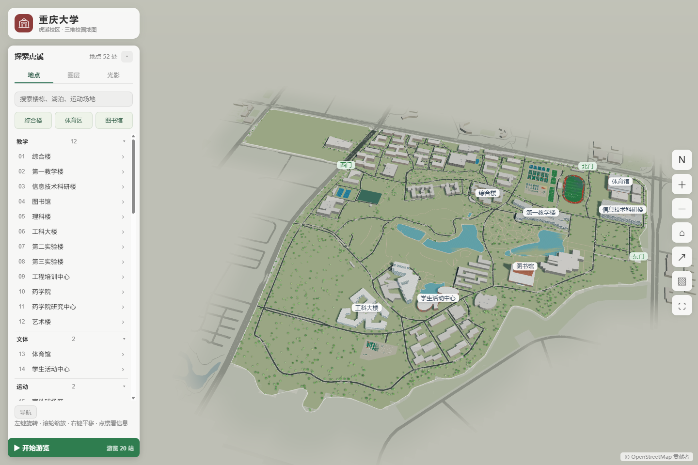
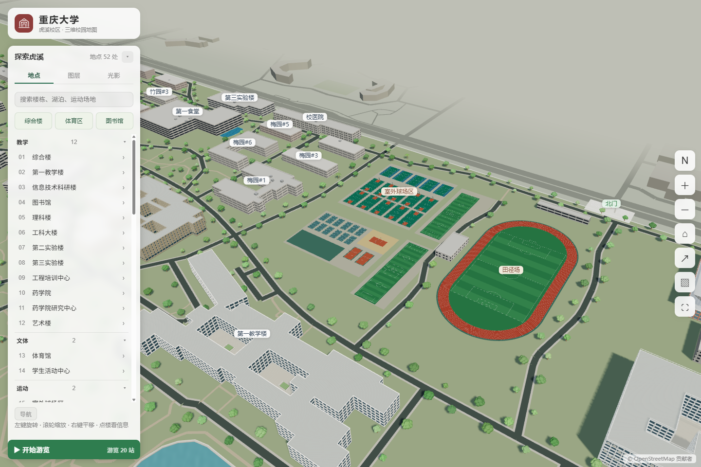

# 重庆大学虎溪校区 3D 地图

Three.js + TypeScript 校园交互地图。普通建筑由 OSM 数据生成，重点地标使用 Blender GLB；参考 [gxu-campus-3d](https://github.com/wcqqq1214/gxu-campus-3d) 的表现方式。

[已发布站点](https://zhipenggui.github.io/cqu-huxi-campus-3d/) · [源码](https://github.com/zhipengGui/cqu-huxi-campus-3d)

**v9 上线候选版在 `feat/huxi-showcase-v9` 本地分支，等待视觉验收，尚未推送或更新线上站点。**

## 预览





## 启动

```sh
npm install
npm run dev
npm run build
```

本地地址 http://localhost:5188/ 。鼠标拖拽旋转、滚轮缩放、右键平移；手机支持触摸。可通过地点列表或搜索定位，切换鸟瞰/立面/近景、光影、图层和画质，也可使用精选巡游及步行导航。

## v9 新增

- 重建体育区统一局部坐标，补齐面层、标线、篮架、球门与球网；14 片独立篮球场、5 片网球场、20 片羽毛球场等按现有数据布置。体育部分合批为 19 次绘制 / 53,251 三角形。
- 根据用户确认，在体育馆旁足球场外围补主田径场。98×180m 布局包络、八道及 1.22m 道宽仍为建模估算，不能作为实测 400m 场地。集合球场和乒乓球区域不猜测内部数量。
- 统一地表配色、场区铺装、树木间距与避让；保留轻量校外环境，原始 OSM 和导航图不改。
- 新增校区身份、综合楼/体育区/图书馆快捷入口及体育场地详情；手机默认收起列表，更多菜单可用分享、导出等工具。
- 分享保存所选地点、光影、面板和相机构图，兼容旧链接，跨桌面/手机按有效视区调整距离。新增加载提示、数据失败重试和模型缺失回退提醒。
- 静态阴影复用；修复 75Hz 等刷新率下帧率上限折半。生产包桌面 1440×960、DPR 1、RTX 5070 Laptop 的最终专项短采样约 60 FPS，仍需实体手机和持续交互验证。

具体证据、取舍和保留问题见 [v9 实施记录](docs/2026-10-16-showcase-v9.md)。

## 地标与环境基础（v7–v8）

- 8 栋建筑：综合楼、第一教学楼、信息技术科研楼、图书馆、理科楼、体育馆、学生活动中心、工科大楼；北门、东门、西门。
- 建筑各有远/近两档 Draco GLB；先载远景，接近且画质允许时再载近景。全部建筑双档合计 9,511,212 字节，三座门约 72 KB；并非首屏一次加载全部近景。
- 综合楼、一教、信息楼、理科楼、工科楼的院落屋面保留真实开口。综合楼包含石材深窗、柱廊和水池；信息楼包含白色框架、后退玻璃、穿孔屏和连廊。
- 全景按真实校园点集投影到有效视区，桌面占宽约 81%；详情支持鸟瞰/立面/庭院近景，手机面板可滚动。整栋选择高亮随 LOD 和光影切换保持一致。
- 校外约 200m 的简化环境：19 栋体块、860 段道路和 23 个地表要素；合计 4 次绘制、7,587 个三角形，无贴图、阴影、拾取和标签。跨范围的公园/水面保留附近部分，地表裁切采用约 24m 的粗略分辨率。
- 校内地表统一按边界筛选，不再将无运动类型的大球场猜成田径场；原始导航图保留。全景标签优先展示地标、湖泊和校门。
- 综合楼新增庭院平台与台阶、深窗收口；一教补入口雨棚/台阶与院内栏杆示意；信息楼强化框架、玻璃退进、庭院平台和连廊骨架。未知位置继续标作估算。

## 数据和模型重建

快照已经入库，日常开发无需联网重抓。修改楼高时编辑 `data/height_overrides.json`，修改地标建模参数时编辑 `data/landmark_details.json`；相关高度要保持一致，再依次重建场景和模型。

```sh
py scripts/build_scene_data.py
blender -b --python scripts/blender/build_priority.py -- --asset all
blender -b --python scripts/blender/build_gates.py
```

单栋示例：`blender -b --python scripts/blender/build_priority.py -- --asset zonghe`。追加 `--no-preview` 可跳过 Blender 图片渲染，仍导出双档 GLB 并保存 .blend。需要本机 Blender 4.5 和可用中文字体；本项目使用 `D:\tools\blender-4.5.9-windows-x64\blender.exe`。旧入口 `build_models.py` 已转发到当前生成器。

产物包括 `public/models/*.glb`、对应导出报告，以及 `work/render/*.blend` 可编辑工程和建模预览。`work/` 不入 Git，可按命令重建。坐标保持原 OSM 方位，原点是外轮廓包围盒中心；浏览器只平移模型，不再随意旋转、缩放以适配占地。

## 验证

```sh
py scripts/test_landmark_geometry.py
py scripts/check_landmarks.py --assets zonghe teaching1 info library likelou gym activity gongke
node scripts/test_views.mts
node scripts/test_context.mts
node --experimental-strip-types scripts/test_sports.mts
node --experimental-strip-types scripts/test_trees.mts
node --experimental-strip-types scripts/test_share.mts
node --experimental-strip-types scripts/test_frame_timing.mts
npm run build
```

启动本地服务后，在 Windows/Chrome 和 Node 22 环境执行 `node scripts/qa_browser.mjs`，截图与报告写入 `work/qa/`。它会实际加载并解码 GLB，检查庭院屋面、11 个地点、竖屏投影、详情按钮、整栋高亮、夜间延迟加载、低画质、搜索、图层、巡游和导航。浏览器尺寸模拟与桌面帧率采样不代表实体手机性能。

GitHub Pages 子路径生产验收：设置 `BASE_PATH=/cqu-huxi-campus-3d/` 后构建，再以 `vite preview --port 5190` 启动。设置 `HUXI_PREVIEW_URL=http://localhost:5190/cqu-huxi-campus-3d/` 后运行 `node scripts/qa_showcase.mjs --ui --release --performance`，检查桌面/手机分享、实际 PNG 下载、数据失败重试、模型回退和静态阴影复用。

## 资料精度

细节由官方资料、照片和现有 OSM 轮廓共同约束，**不是测绘复原**。一教有五层及互通楼翼的文字证据，完整立面资料不足；综合楼、信息楼楼高仍按层数推算。信息楼资料中的 36 m 是连廊跨度，9.4 m 是桁架高度。

工科大楼和西门仍是保守示意，缺少已核实的外观照片。其他建筑的窗距、背立面、庭院深度与部分构件位置也含估算；树木是示意分布。详见 [v9 实施记录](docs/2026-10-16-showcase-v9.md)、[v8 实施记录](docs/2026-10-16-context-v8.md)、[v7 资料记录](docs/2026-10-16-landmarks-v7.md) 和 `data/landmark_details.json`。保留小问题：一处斜边泳池标线超出面层，Python 院落采样测试的内缩量与浏览器检查不同；详见验收记录。

## 许可

代码采用 [MIT License](LICENSE)。地图数据 © OpenStreetMap 贡献者，ODbL；参考照片来自重庆大学公开图集，照片权利属于原权利人。Draco 解码器使用 Apache License 2.0，见 `public/draco/`。
