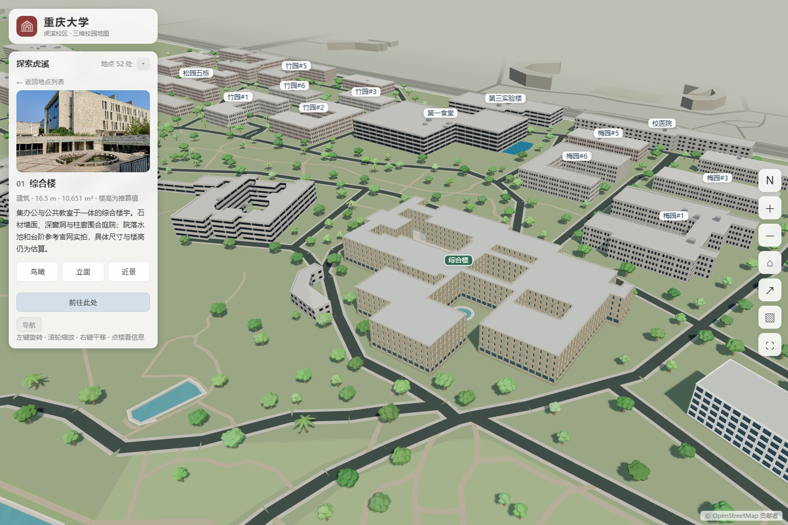

# 重庆大学虎溪校区 3D 地图

在浏览器中漫游虎溪校园，探索教学楼、图书馆、湖泊与运动场地。这是一张支持旋转、缩放和交互导览的三维校园地图，可通过电脑或手机访问。

**[打开地图 · 在线体验 →](https://zhipenggui.github.io/cqu-huxi-campus-3d/)**

[项目源码](https://github.com/zhipengGui/cqu-huxi-campus-3d) · [反馈问题与建议](https://github.com/zhipengGui/cqu-huxi-campus-3d/issues)


## 探索虎溪

- **校园地标**：综合楼、第一教学楼、信息技术科研楼、图书馆、理科楼、体育馆、学生活动中心与工科大楼，以及北门、东门和西门。
- **湖景与运动场地**：浏览缙湖、云湖及校园绿地，查看田径场、足球场、篮球场、网球场等运动区域。
- **地点搜索**：按名称搜索建筑、湖泊或运动场地，点击地图或地点列表查看介绍并定位。
- **多种观察视角**：重点建筑支持鸟瞰、立面和庭院近景，方便观察建筑布局与细节。
- **校园导览**：跟随精选巡游探索校园，也可以选择起终点查看步行路线。
- **桌面步行漫游**：从综合楼、一教、信息楼或图书馆附近进入，用鼠标观察、WASD 沿校园道路移动。
- **光影与分享**：切换清晨、日间、黄昏和夜间光影，调整图层与画质，分享当前视角或导出地图图片。

## 画面预览

| 体育区 | 综合楼 |
| --- | --- |
|  |  |

## 如何使用

| 操作 | 电脑 | 手机 |
| --- | --- | --- |
| 旋转视角 | 鼠标左键拖拽 | 单指拖动 |
| 缩放地图 | 鼠标滚轮 | 双指捏合 |
| 平移地图 | 鼠标右键拖拽 | 双指拖动 |
| 查看地点 | 点击建筑、标签或地点列表 | 点按建筑、标签或地点列表 |

点击“综合楼”“体育区”“图书馆”快捷入口可以快速开始探索。工具栏中的主页按钮可返回校园全景；手机端点击右上角“···”可展开缩放、分享和图片导出等工具。

点击“路线导航”，选择起点和终点，也可用“地图选点”指定位置；支持交换两端点与从地点详情直接导航。路线目的地目前为附近道路，楼门位置尚待核实。

电脑端点击“步行漫游”，选择地点后点击开始，浏览器会锁定鼠标。使用 WASD 移动、鼠标转向，按 Esc 返回地图。漫游为平面室外体验，通行范围依据已映射的道路与铺装，建筑、水面和校界设有基础碰撞。

## 本地运行

项目使用 **Three.js、TypeScript 和 Vite**，以静态网页形式运行。普通建筑与地表来自 OpenStreetMap 数据，重点地标采用 Blender 建模，并按观察距离加载不同精度的模型。

准备 Node.js 22 和 npm，在项目目录中执行：

```sh
npm ci
npm run dev
```

打开 [http://localhost:5188/](http://localhost:5188/) 即可预览。

构建生产版本：

```sh
npm run build
```

产物位于 `dist/`。部署到子目录时，通过环境变量 `BASE_PATH` 设置站点路径；本项目 GitHub Pages 使用 `/cqu-huxi-campus-3d/`。

数据管线、模型生成及维护说明见 [架构文档](docs/架构备忘.md) 和 [项目资料](docs/交接文档.md)。

## 关于地图

地图面向校园展示与探索，由现有地图轮廓、公开资料和参考照片共同构建。建筑细节、植被分布及部分场地尺寸包含示意或估算，欢迎通过 [Issues](https://github.com/zhipengGui/cqu-huxi-campus-3d/issues) 提供照片、位置校正和使用建议。

## 致谢与许可

- 项目的视觉表现与实现参考了 [gxu-campus-3d](https://github.com/wcqqq1214/gxu-campus-3d)。
- 代码采用 [MIT License](LICENSE)。
- 地图数据 © [OpenStreetMap 贡献者](https://www.openstreetmap.org/copyright)，遵循 ODbL。
- 参考照片来自重庆大学公开图集，照片权利属于原权利人。
- Draco 解码器采用 Apache License 2.0，详见 [public/draco](public/draco/)。
